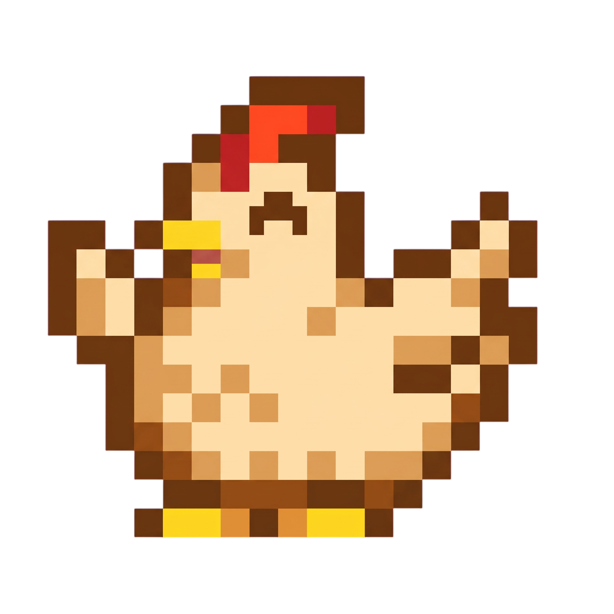

<!-- 1. BANNER SUPERIOR -->

  

 

<!-- 2. ILUSTRACIÓN / GIF FLOTANTE A LA DERECHA -->

<!-- 3. INFORMACIÓN PERSONAL Y BIOGRAFÍA -->
# 🤠 ¡HOLA, SOY LENIN!

*Desarrollador de Software / Programador*

Soy desarrollador de software enfocado en la construcción de aplicaciones web y de escritorio, con interés en optimización y buenas prácticas de desarrollo.

- 🎓 Estudiante de desarrollo de software.
- 🔭 Actualmente enfocado en proyectos web modernos y software de escritorio.
- 🌱 Aprendiendo y profundizando en arquitecturas limpias y despliegue continuo.
- 💬 Pregúntame sobre desarrollo frontend, backend o bases de datos.
- 🌐 Visita mi [Portafolio](https://unusual-pear-420241.framer.app/) para ver mis proyectos en producción.

 

<!-- 4. CONTADOR DE VISITAS DINÁMICO -->

